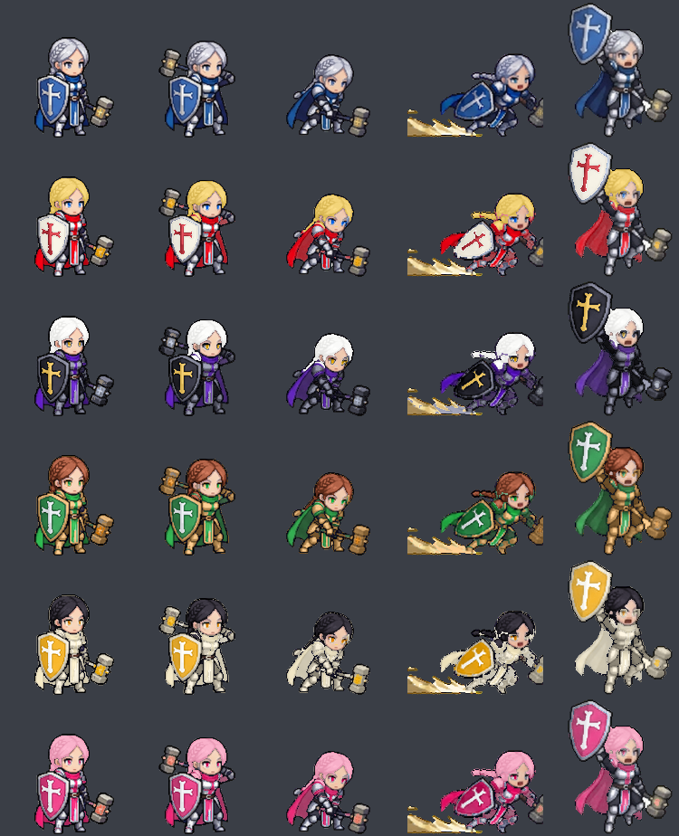

# 성기사 추가 외형 색조합 (2026-11-04)

외형 0(은발 땋은 머리·은 갑옷·청색 망토·파란 십자 방패·금 망치)의 색 조합 변형 외형 1~5.
게임 시트는 `assets/sprites/merc/paladin_1~5.webp`이고, `python tools/paladin_variants_build.py`로 0번 시트 20칸 전체에 색을 입혀 만든다.
피부·검은 윤곽·흰자·가죽(허리띠·장갑)과 스킬 이펙트(금빛)는 모든 외형에서 그대로 둔다.

확인 그림: `python tools/paladin_variants_build.py preview <경로>` (외형 0~5 × 20칸), `python tools/paladin_variants_build.py masks <경로>` (부위 나누기)

## 시트에 쓴 색
각 부위의 시트 전체 가운데 색을 이 값에 맞추고 명암 차이는 살린다. 원래 가운데 밝기가 갑옷 0.48, 망토 0.34로 어두워서, 밝은 목표는 낮춰 잡아야 명암이 남는다.
갑옷 칸은 은색 금속 전부(방패 테두리·망치 머리 포함), 망토 칸은 파란 천 전부(망토·스카프·앞자락·망치 손잡이 띠)다.

| 번호 | 이름 | 머리 | 눈 | 갑옷 | 망토 | 방패 바탕 | 십자 | 망치 금장식 |
|---|---|---|---|---|---|---|---|---|
| 1 | 진홍 성전단 | 금발 `#e8c45a` | 파랑 `#3a7bd5` | 은색 그대로 | 진홍 `#b8202c` | 아이보리 `#ece8dc` | 진홍 `#b8202c` | 금 `#d9a63a` |
| 2 | 칠흑 심판관 | 백발 `#f2f2f0` | 금 `#c9a033` | 흑철 `#3c3d48` | 짙은 보라 `#4a2a7a` | 검정 `#22222a` | 금 `#e2b545` | 어두운 강철 `#8a8f9c` |
| 3 | 숲의 수호자 | 적갈 `#8a3f26` | 초록 `#3f9a5a` | 청동 `#9a7444` | 짙은 초록 `#2d6b3c` | 초록 `#2f7a46` | 은 `#d8dde2` | 청동 `#b07a3a` |
| 4 | 태양의 성전사 | 흑발 `#2a2630` | 호박 `#d08a2a` | 따뜻한 회색 `#aaa392` | 크림 `#d4ccb4` | 금 `#e0a62a` | 흰색 `#f8f6ee` | 금 `#e2b23a` |
| 5 | 장미 기사 | 분홍 `#f09ab8` | 자주 `#c84a7a` | 은색 그대로 | 자주 `#b23a6a` | 장미 `#c43b74` | 은백 `#e8e8ec` | 로즈골드 `#d98a7a` |

처음 설계에서 바뀐 값: 1·5 갑옷(`#c9ccd4`·`#d8d9df`)은 원래보다 하얗게 날아가서 은색 그대로 두었다.
3 갑옷 `#b78a4e`는 `#9a7444`로 낮췄다. 4 상아 갑옷 `#eceae0`과 흰 망토 `#f4f0e4`는 한 덩어리로 뭉쳐서 따뜻한 회색과 크림으로 나눴다.

## 원칙
- 방패 바탕과 십자는 밝기 대비를 크게 (1·4 밝은 바탕에 진한 십자, 2·3·5 진한 바탕에 밝은 십자).
- 망토와 방패는 같은 계열로 묶고, 조합마다 바뀌는 큰 덩어리는 2~3개까지.
- 기사 외형(흑철·진홍, 청록·올리브, 청색·남색)과 겹치지 않게. 청록은 기사 2가 써서 뺐음.

## 설계 단계 거친 미리보기

`python tools/paladin_palette_preview.py docs/paladin-skin-palette.png` (설계 때 쓴 값 그대로, 대기 칸만)
