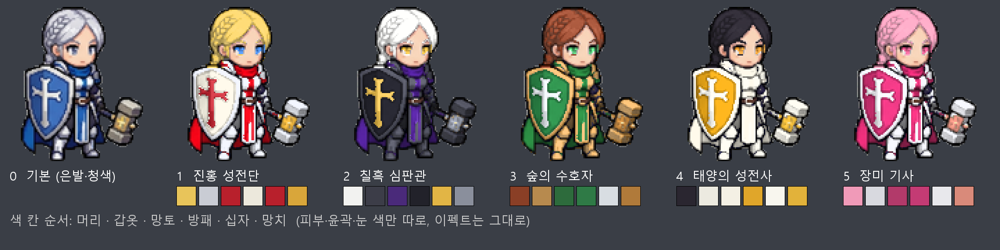

# 성기사 추가 외형 색조합 (2026-11-04)

외형 0(은발 땋은 머리·은 갑옷·청색 망토·파란 십자 방패·금 망치)을 기준으로 한 추가 외형 1~5 후보.
피부·검은 윤곽·흰자와 스킬 이펙트(금빛)는 모든 외형에서 그대로 둔다.

미리보기: `python tools/paladin_palette_preview.py docs/paladin-skin-palette.png` (대기 칸 거친 리컬러, 금 테두리 등 세부는 빠짐)

| 번호 | 이름 | 머리 | 눈 | 갑옷 | 망토 | 방패 바탕 | 십자 | 망치 머리 |
|---|---|---|---|---|---|---|---|---|
| 1 | 진홍 성전단 | 금발 `#e8c45a` | 파랑 `#3a7bd5` | 은 `#c9ccd4` | 진홍 `#b8202c` | 아이보리 `#ece8dc` | 진홍 `#b8202c` | 금 `#d9a63a` |
| 2 | 칠흑 심판관 | 백발 `#f2f2f0` | 금 `#c9a033` | 흑철 `#3c3d48` | 짙은 보라 `#4a2a7a` | 검정 `#22222a` | 금 `#e2b545` | 어두운 강철 `#8a8f9c` |
| 3 | 숲의 수호자 | 적갈 `#8a3f26` | 초록 `#3f9a5a` | 청동 `#b78a4e` | 짙은 초록 `#2d6b3c` | 초록 `#2f7a46` | 은 `#d8dde2` | 청동 `#b07a3a` |
| 4 | 태양의 성전사 | 흑발 `#2a2630` | 호박 `#d08a2a` | 상아 `#eceae0` | 흰색 `#f4f0e4` | 금 `#e0a62a` | 흰색 `#f8f6ee` | 금 `#e2b23a` |
| 5 | 장미 기사 | 분홍 `#f09ab8` | 자주 `#c84a7a` | 은 `#d8d9df` | 자주 `#b23a6a` | 장미 `#c43b74` | 은백 `#e8e8ec` | 로즈골드 `#d98a7a` |

## 원칙
- 방패 바탕과 십자는 밝기 대비를 크게 (1·4 밝은 바탕에 진한 십자, 2·3·5 진한 바탕에 밝은 십자).
- 망토와 방패는 같은 계열로 묶고, 조합마다 바뀌는 큰 덩어리는 2~3개까지.
- 기사 외형(흑철·진홍, 청록·올리브, 청색·남색)과 겹치지 않게. 청록은 기사 2가 써서 뺐음.
- 갑옷 테두리·장식: 1·2·4는 금, 3은 청동, 5는 로즈골드.
