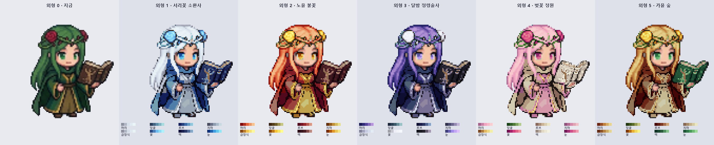
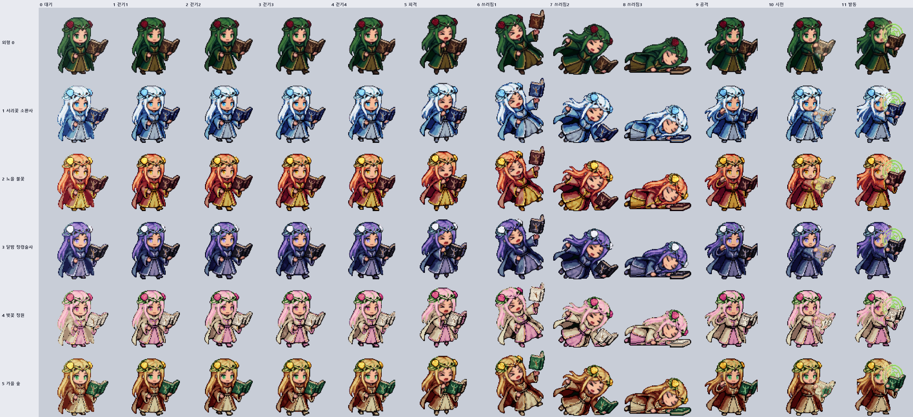

# 소환사 추가 외형 색조합 (2026-11-05)

외형 0(초록 긴 머리·장미 화관·초록 로브·올리브 치마·갈색 마법서)의 색 조합 변형 외형 1~5 후보.
아직 게임 시트가 아니라 **대기 칸만 색을 입힌 샘플**이다. 고르면 성기사처럼 0번 시트 12칸 전체에 색을 입히는 도구를 따로 만든다.
피부·검은 윤곽·흰자·책 표지 금박 무늬는 모든 외형에서 그대로 둔다.

## 전체 시트 (12칸)
`assets/sprites/merc/summoner_1~5.webp` — `python tools/summoner_variants_build.py`로 0번 시트 12칸 전체에 색을 입혀 만든다 (칸 구성·크기·기준점은 0번과 같음). **아직 게임에 등록하지 않음** (`MERC_SPRITE_DEFS.summoner_1~5`·외형 수).

확인 그림: `python tools/summoner_variants_build.py preview <경로>` (외형 0~5 × 12칸) · `detail <경로> <칸>` (그 칸과 대기 칸을 외형 0~5로 확대) · `masks <경로>` (부위 나누기)

대기 칸 샘플에서 지적받아 고친 규칙을 칸마다 똑같이 쓰되, 자세가 달라 자리로 정하던 규칙은 칸마다 찾게 바꿨다:
- 얼굴 = 그 칸의 가장 큰 살색 덩어리 (볼록 껍질). 눈 = 얼굴 가운데 높이 띠의 초록 (서 있는 칸만, 피격·쓰러짐은 눈 감음)
- 장미 = 평균 색조 345~355°·채도 0.5 넘는 빨강 덩어리 (15픽셀 넘고, 서 있는 칸은 얼굴 위쪽 40% 안). 손·목의 붉은 그늘은 색조 0~11°라 빠짐
- 머리 = 정수리 초록(장미 둘레 6칸 · 서 있는 칸은 얼굴 위쪽)에서 이어진 밝은 초록. 어두운 띠로 끊긴 갈래는 3칸 안이면 이어 붙임 (쓰러짐 1칸 늘어진 머리, 공격 칸 날리는 머리)
- 화관 덩굴 = 장미 둘레 5칸 + 서 있는 칸 정수리 띠의 짙은 초록 (누운 칸은 장미 둘레만)
- 망토 깊은 그늘(채도 있는 짙은 초록, 밝기 0.07~0.14)은 윤곽이 아니라 로브 (걷기·공격 칸 망토가 원래 초록으로 남던 것)
- 책 = 가장 큰 갈색 덩어리, 빛나는 책 종이(시전 칸)·소환 빛(발동 칸 연둣빛 마법진)은 그대로
- 명암 계단 범위는 부위마다 시트 전체로 잡아 칸끼리 같은 색이 같은 계단에 옴

칸별 점검에서 고친 것: 장미가 손 그늘에도 잡힘 · 누운 칸 머리가 덩굴 색 · 쓰러짐 1칸·공격 칸 왼쪽 머리가 로브 색 · 공격 칸 목 두건이 덩굴 색(옷깃 붉은 그늘이 장미로) · 망토 깊은 그늘이 원래 초록 · 시전 칸 책 종이가 치마 색

다시 그리기: `python tools/summoner_palette_preview.py docs/summoner-skin-palette.png` · 부위 나누기 확인: `python tools/summoner_palette_preview.py <경로> masks`

## 색 입히는 법 (픽셀아트 저장소 기법)
- **색조가 도는 명암 계단** (pixel-art-studio `ramp`, pxl `shades`): 부위마다 목표 색 하나로 계단을 만든다. 그림자는 파랑 쪽, 밝은 곳은 노랑 쪽으로 최대 16° 돌고, 채도는 중간 밝기에서 가장 높다. 그냥 어둡게·밝게 하면 흙빛으로 뭉개진다.
- **명암 모양은 그대로**: 원래 픽셀이 그 부위 안에서 얼마나 밝은지(아래 5%~위 95%)를 계단 위 자리로 옮긴다.
- **같은 재질은 한 계단**: 로브와 두건, 치마와 소매 안감은 같은 색이다. 큰 색 덩어리는 머리·로브·치마 셋으로 묶고, 꽃·눈·책이 포인트다.
- **윤곽선 (selout)**: 원래 검은 윤곽 픽셀은 가장 가까운 부위(2칸 안)의 맨 아래 색 색조로, 어두움은 그대로 둔다. 초록빛 검은 윤곽이 붉은·분홍 로브 위에 청록 테두리로 남지 않게. 피부에 붙은 윤곽은 그대로.
- **명암 계단 아래쪽 연장**: 부위 안 아래 5%보다 어두운 픽셀(머리카락 결·접힌 선)은 계단 맨 아래 색보다 원래 어두운 만큼 더 어둡게. 은백·연분홍 같은 밝은 머리도 결이 뭉개지지 않는다.
- 마법사 외형(은회색·진홍, 민트·보라, 주황·검정, 분홍·청록, 금발·초록)과 겹치지 않게 잡았다.

## 후보 색 (목표 색 = 계단 가운데)

| 번호 | 이름 | 머리 | 화관 덩굴 | 로브 | 치마 | 금장식 | 꽃 | 책 | 눈 |
|---|---|---|---|---|---|---|---|---|---|
| 1 | 서리꽃 소환사 | 은백 `#d6dfeb` | 청회 `#5f8fa8` | 얼음 청 `#3c6aa4` | 은회 `#8e9bb0` | 은 `#d4dce8` | 하늘 `#6fbdf0` | 남색 `#2b3a68` | 하늘 `#3f9fe0` |
| 2 | 노을 불꽃 | 주홍 `#e2643c` | 마른 잎 `#6b5a2a` | 진홍 `#962a2c` | 금 `#bf9038` | 금 `#f0c252` | 노랑 `#f6c43a` | 검붉음 `#4a2024` | 호박 `#e09a2a` |
| 3 | 달밤 정령술사 | 남보라 `#55449a` | 청록 그늘 `#3d5a6a` | 짙은 남색 `#28325e` | 회보라 `#6c6690` | 은 `#c6cbe2` | 흰 달꽃 `#ecedf6` | 검정 `#26232f` | 연보라 `#a48cea` |
| 4 | 벚꽃 정원 | 연분홍 `#f0a4c0` | 잎 초록 `#4f7a3a` | 크림 `#c9b394` | 분홍 `#d48aa8` | 금 `#e2b862` | 진분홍 `#d23f7c` | 상아 `#e2d8c6` | 분홍 `#d0508a` |
| 5 | 가을 숲 | 호박 `#c0803e` | 올리브 `#5a6a2a` | 짙은 녹빛 적갈 `#7e3b24` | 크림 `#c4b088` | 청동 `#b48242` | 노랑 `#eab232` | 짙은 초록 `#2a5c3c` | 초록 `#4a9a5a` |

## 세부 점검에서 고친 것 (8배 확대, 칸마다)
- 윤곽선: 원래 초록빛 검은 윤곽이 그대로 남아 2·4·5번 로브에 청록 테두리가 보였음 → selout
- 머리 끝: 반투명 가장자리·채도 낮은 회녹색·청록빛 그늘(색조 185~195°)·화관 둘레 누런 초록이 원래 색으로 남았음 → 부위에 넣음
- 눈동자: 홍채 아래쪽 흐린 초록이 남았음 → 채도 기준을 낮춤 (눈 왼쪽 앞머리 x 54~56은 머리로)
- 책: 5번에서 밝은 종이 가장자리까지 표지 색이 됐음 → 표지(밝기 0.5 아래)만
- 5번 가을 숲: 머리와 로브가 둘 다 적갈색이라 어깨에서 뭉쳤음 → 머리는 밝은 호박, 로브는 짙은 녹빛 적갈
- 얼굴: 화관 가운데 장식이 치마로, 입술이 금장식으로, 얼굴 오른쪽 끝이 책으로 잡혀 이마·입·볼에 다른 색이 들었고, 얼굴 테두리·속눈썹은 원래 초록빛 선 그대로였음 → 얼굴(살색 덩어리의 볼록 껍질, 앞머리 아래)은 눈 말고 어떤 부위로도 칠하지 않고, 얼굴 안 초록빛 선은 피부 그늘 갈색 `#6a3428`로 (어두움은 그대로). 치마·금장식은 몸통(y 56 아래)에서만
- 머리 갈래: 얼굴 양옆에서 로브 위로 늘어진 두 갈래가 로브 색이었음 → 어깨 아래는 자리 대신 색으로 나눔 (머리 초록 색조 103~140°·밝음, 로브 초록 145~177°·어두움, 경계 142°)
- 눈 둘레 갈색 테: 원래 흰자가 초록빛 회색이라 얼굴 선으로 잡혀 갈색이 됐었음 → 얼굴 안 선을 넷으로 나눔: 흰자(밝기 0.5 위) = 무채색 그대로, 눈 모서리 그늘 = 그 외형 눈동자 계단 맨 아래 색, 머리와 맞닿은 선 = 머리 윤곽 색, 나머지 진한 속눈썹 = 거의 검은 갈색(밝기 0.2까지)
- 로브 얼룩: 로브 밝은 면도 색조가 142° 아래로 내려가는 곳(오른쪽 소매·아랫자락)이 머리로 잡혀 머리색 얼룩이 생겼었음 → 색으로 잡는 머리는 손 높이(y 80) 위에서, 머리에서 이어진 덩어리만
- 옷 얼룩 (2차): 로브 가장자리 푸른빛 회색 그늘(색조 195~270°)·밝은 회색 점이 어느 부위에도 안 들어가 원래 색으로 남았음 → 둘레 8칸에 가장 많은 옷 부위로. 오른쪽 소매 끝 금테는 책 금박으로, 치마의 채도 낮은 금테(색조 32° 넘음)는 살색으로 잡혀 원래 금색이었음 → 소매 끝은 책 상자에서 빼고, 몸통의 그런 금테는 금장식·치마로. 밝고 연한 목표 색(크림·은백)은 그늘을 덜 내리고, 계단 아래 연장은 머리만 0.35배·옷은 0.7배까지 (4번 크림 로브 깊은 그늘이 흙빛 얼룩이 되던 것)
- 망토 얼룩: 원본의 잔 명암 잡티를 그대로 따라가고, 망토의 밝은 주름이 계단 가장 밝은 끝(진한 색 로브에선 분홍빛)에 놓여 얼룩덜룩했음 → 로브·치마는 같은 부위 이웃 3×3 가운데값으로 명암을 고르게 편 뒤 5단으로 끊고(재질 하나 3~5색, 단 사이 밝기 15~25%), 밝은 끝을 덜 하얗게(0.62 → 0.38)
- 왼쪽 머리카락 사이 흰 배경: 0번 시트 자체에 남아 있었음 (대기 칸 머리 왼쪽 반투명 회청색 줄, 피격·쓰러짐 첫 칸·소환 발동 칸 머리카락 사이 흰 덩어리) → `tools/sprite_bg_cleanup.py`로 시트에서 지움

## 고를 때 볼 점
- 4 벚꽃 정원의 크림 로브는 밝아서 치마와 대비가 약하다. 고르면 로브를 한 단 어둡게 잡는다.
- 1 서리꽃은 머리가 거의 흰색이라 밝은 바닥 맵에서 윤곽에 기대게 된다.
- 부위 나누기는 대기 칸 자리 기준이라, 12칸 전체에 입힐 때는 칸마다 머리와 로브(둘 다 초록) 경계를 다시 잡아야 한다.
